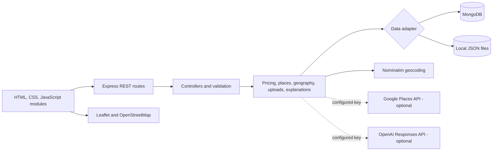

# Farewise

**Location-aware fare guidance and local place discovery for travelers.**

Farewise compares a quoted fare with a city and service reference rate and comparable fare reports. It returns an estimated range, a rule-based verdict, the number of samples used, and the signals behind the result. The Explore experience helps travelers discover nearby places, read and contribute reviews, and browse practical local tips.

> **Prototype data notice:** Seeded fares, travel tips, ratings, review counts, and review excerpts are synthetic examples for demonstration. They are not verified customer reports or current market prices. Farewise is decision support, not a guarantee or a determination that a provider has acted improperly.

## Product overview

- **Fare checks:** Compare taxi, auto, guide, restaurant, tour, and airport-transfer quotes against configured rates and comparable reports.
- **Explainable estimates:** Show an estimated low-to-high range, midpoint, verdict, sample count, confidence label, comparison signals, and nearby tips.
- **Location-aware discovery:** Browse regional places by selected city or, after granting browser permission, around the device's current coordinates.
- **Maps and route entry:** View location-based tips and select pickup or destination points on a Leaflet map.
- **Traveler contributions:** Submit fare reports, local tips, place reviews, and optional photos.
- **Optional integrations:** Use Google Places for live nearby attractions and ChatGPT for plain-language explanations when server-side credentials are configured.

Current regional seed coverage includes Guwahati, Shillong, Silchar, Imphal, Kohima, Itanagar, and Jaipur. The Guwahati discovery reference is near Assam Engineering College in Jalukbari, with coverage across the wider city.

## Architecture

Farewise is a **layered modular monolith**: one Express application organized into routes, controllers, services, middleware, configuration, models, and data access. The browser is a modular JavaScript single-page interface. MongoDB is the persistent-store option; a local JSON adapter supports development without a database.



### Request flow

1. A browser module sends a JSON request to an API route.
2. The route wraps the controller with async error handling.
3. The controller validates input and calls the relevant service.
4. Services apply fare, location, data, or upload logic and use the database adapter.
5. The controller returns a JSON response for the browser to render.

## Technology stack

| Layer                | Technology                       | Purpose                                                        |
| -------------------- | -------------------------------- | -------------------------------------------------------------- |
| Runtime              | Node.js 18+                      | JavaScript runtime for the server                              |
| API                  | Express 4                        | REST endpoints and static-file hosting                         |
| Data                 | MongoDB Node.js driver 6         | MongoDB collections and indexes                                |
| Local persistence    | JSON files                       | Development/demo fallback when MongoDB is unavailable          |
| Frontend             | HTML, CSS, JavaScript ES modules | Single-page interface without a frontend build step            |
| Map                  | Leaflet, OpenStreetMap tiles     | Interactive maps, report markers, and map pin selection        |
| Geocoding            | Nominatim                        | Place-name lookup, called through the server                   |
| Optional place data  | Google Places API (New)          | Live attraction results, ratings, reviews, and photos          |
| Optional explanation | OpenAI Responses API             | Plain-language explanation of a completed deterministic result |
| Formatting           | Prettier                         | Consistent formatting                                          |

## Quick start

### Requirements

- Node.js 18 or newer
- npm
- Docker Desktop only if you want to run MongoDB locally

### Run without MongoDB

The local JSON adapter lets you start the application without Docker or a database:

```bash
git clone https://github.com/TanujKatel16/FareWise.git
cd FareWise
npm ci
npm start
```

Open [http://localhost:3000](http://localhost:3000). The server uses the JSON fallback for user-submitted data when MongoDB is not configured or available.

### Run with MongoDB

Copy `.env.example` to `.env`, then start MongoDB and load the seed data:

```bash
docker compose up -d
npm ci
npm run seed
npm start
```

The default local MongoDB URI is `mongodb://127.0.0.1:27017`, with database name `farewise`. Update `.env` if your MongoDB instance uses a different connection string. Do not commit `.env` or credentials.

### Seed data commands

```bash
npm run build:seed   # Regenerate data/seed.json from scripts/build-seed.cjs
npm run seed         # Upsert the generated service, fare, and tip records into MongoDB
```

## Configuration

All secrets belong in an untracked `.env` file. `.env.example` contains safe placeholders.

| Variable              | Required | Description                                                                      |
| --------------------- | -------- | -------------------------------------------------------------------------------- |
| `PORT`                | No       | HTTP port; defaults to `3000`                                                    |
| `MONGODB_URI`         | No       | MongoDB connection URI; without a working connection, local JSON storage is used |
| `MONGODB_DB`          | No       | MongoDB database name; defaults to `farewise`                                    |
| `OPENAI_API_KEY`      | No       | Enables ChatGPT explanations through the OpenAI Responses API                    |
| `OPENAI_MODEL`        | No       | Explanation model; defaults to `gpt-4.1-mini`                                    |
| `GOOGLE_MAPS_API_KEY` | No       | Enables server-side Google Places requests and photo proxying                    |

The price verdict is calculated before any OpenAI request. ChatGPT receives the completed result and may explain it; it does not choose or change the numeric price or verdict. If the key is absent or the API call fails, a local template generates the explanation.

Google Places is also optional. It requires a Google Cloud project, Places API (New), billing, and a server-side key restricted to the required API. Google Maps Platform may incur charges; configure quotas and budget alerts. Without a key, Farewise uses its regional place catalogue and Wikimedia Commons photos when available.

## Fare estimation

Farewise uses deterministic application logic rather than an LLM to calculate prices.

### 1. Reference fare

Each city and service has a configured pricing model. A per-kilometer service uses:

```text
reference fare = base fare + (per-kilometer rate × trip distance)
```

Flat, per-person, and per-meal services use their configured base amount.

### 2. Comparable reports

The engine selects reports for the same city and service. For distance-based services, it prefers reports within 20% of the requested distance. If pickup coordinates and report-origin coordinates are available, a report within 12 km can remain eligible even when its trip distance differs more. Per-kilometer prices are normalized to the requested trip distance.

Eligible reports are weighted by distance similarity and, when coordinates are available, pickup proximity. The weighted mean becomes the community estimate; weighted 25th and 75th percentiles describe its spread.

### 3. Blend and range

The reference fare and community estimate are blended according to sample count. With fewer than five reports, the community weight increases by 3.5 percentage points per report. From five to fourteen reports, it rises from 14% by 5.5 points per additional report. From fifteen reports onward, it begins at 69%, rises by one point per additional report, and is capped at 82%.

The range is derived from the blended estimate and the weighted interquartile spread, with guardrails to prevent an extremely narrow or wide range. If no comparable reports exist, the configured reference fare is used.

### 4. Verdict and confidence

The quote-to-midpoint ratio is adjusted slightly by up to three nearby relevant fare-tip records. The rule-based verdict thresholds are:

| Adjusted ratio             | Verdict    |
| -------------------------- | ---------- |
| Up to `1.20`               | Fair       |
| Above `1.20`, up to `1.58` | Suspicious |
| Above `1.58`               | High Risk  |

Confidence is a sample-count label, not a probability: fewer than five comparable reports is Low; five to fourteen is Medium; fifteen or more is High. Thresholds and seed rates are prototype settings and should be evaluated against verified local observations before real-world reliance.

## Location, maps, and places

- Browser geolocation is requested only through the browser permission flow. The user can select a city manually if permission is unavailable.
- The nearest supported city is selected using Haversine distance. When both route points are available, the frontend estimates straight-line distance with the same method; this is not road distance and does not account for traffic.
- Leaflet renders OpenStreetMap tiles, report markers, and map-pin selection. Marker size reflects report count, while color reflects severity.
- Nominatim lookup is proxied through the backend and throttled/cached in process.
- The demo catalogue contains 48 places overall, including 29 labelled Guwahati. Seeded ratings and review snippets are synthetic and labelled in the interface.
- Wikimedia Commons imagery is discovered in the browser when a suitable image is available, and attribution is shown. Google Places images are optional and use a server-side photo proxy.

## Data, uploads, and privacy considerations

The repeatable seed builder creates 384 synthetic fare reports and 51 synthetic travel-tip entries across seven supported regions. Guwahati has 96 sample fare reports and 21 sample tip scenarios. These records demonstrate how the product works; they are not actual historical customer transactions or verified current prices.

User-submitted fare reports and reviews are stored in MongoDB when connected, otherwise in `data/user-data.json`. Optional image evidence is validated and saved under `data/uploads/` in the local implementation. Photos are limited to 5 MB and supported image formats. A hosted deployment should use persistent object storage and HTTPS.

The browser requires permission before sharing device location. Coordinates used for a fare check are removed from the saved check input. Location information included in a user-submitted report may be stored with that report. The prototype does not include user accounts, a full moderation workflow, rate limiting, or production-grade abuse prevention; do not expose it publicly as-is.

## API reference

All endpoints are served under `/api` and exchange JSON except photo responses.

| Method | Path                         | Purpose                                                                                   |
| ------ | ---------------------------- | ----------------------------------------------------------------------------------------- |
| `GET`  | `/api/config`                | Return supported cities, services, record counts, and integration status                  |
| `POST` | `/api/check`                 | Calculate a fare estimate, verdict, signals, and optional explanation                     |
| `POST` | `/api/reports`               | Validate and store a user-submitted fare report                                           |
| `POST` | `/api/complaints`            | Store a traveler tip and create a map/tip entry when location details are provided        |
| `GET`  | `/api/traps`                 | List tips with city, category, service, and optional proximity filters                    |
| `GET`  | `/api/map-data`              | Return report/tip data for map markers with city, service, and optional proximity filters |
| `GET`  | `/api/geocode?q=...`         | Search place names through Nominatim                                                      |
| `GET`  | `/api/places/nearby`         | Return nearby live Google Places or sorted regional catalogue results                     |
| `GET`  | `/api/places/photo?name=...` | Proxy a Google Places photo when configured                                               |
| `POST` | `/api/places/reviews`        | Validate and store a place review and optional photo                                      |

## Repository layout

```text
config/          Environment and MongoDB connection
controllers/     HTTP request validation and response handling
data/            Seed catalogue and generated reference data
middlewares/     Express setup, security headers, and error handling
models/          MongoDB collection index definitions
public/          HTML, browser modules, and stylesheets
routes/          Express API route definitions
scripts/         Seed generation and MongoDB loading
services/        Pricing, data access, geography, places, uploads, explanations
```

## Development

```bash
npm run dev           # Restart the server when files change
npm run format        # Format supported project files with Prettier
npm run format:check  # Check formatting without changing files
```

There is not yet an automated test suite. Before submitting a change, run the formatter check and manually verify the affected flow. Keep synthetic records clearly labelled and never commit API keys, `.env`, local user data, or uploaded files.

See [CONTRIBUTING.md](CONTRIBUTING.md) for contribution guidance and [SECURITY.md](SECURITY.md) for vulnerability reporting guidance.

## License

No open-source license has been selected for this repository. Until a license is added, do not assume that public visibility grants permission to reuse, modify, or redistribute the code.
